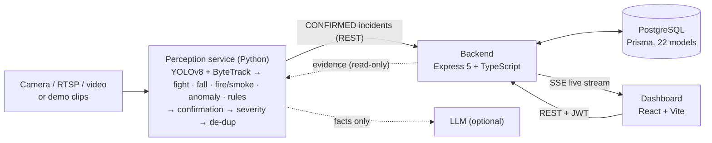
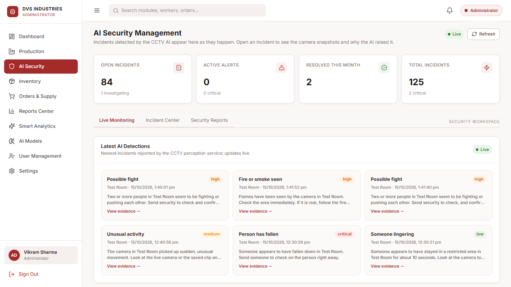
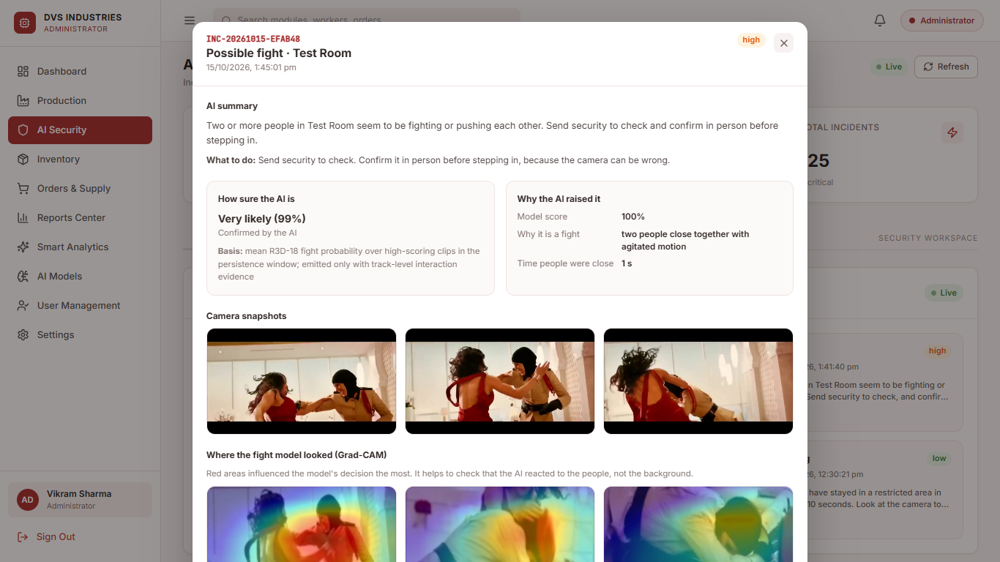
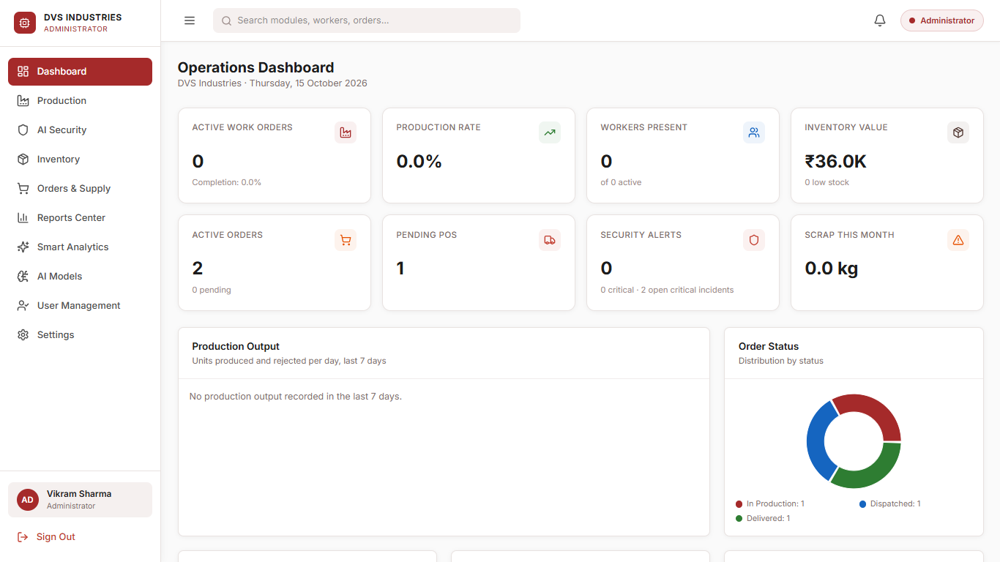

# DVS Industries: ERP with multi-model CCTV safety AI

A full-stack ERP for a manufacturing plant (workforce, inventory, orders,
production, reports, analytics) with an integrated CCTV AI. The AI detects
fights, falls, fire/smoke, crowding and unusual activity,
and turns each event into **one** incident with evidence. The incident appears
live on every open dashboard.

> Final-year project. All model numbers below come from
> [docs/RESULTS.md](docs/RESULTS.md), generated from the training metrics files.

## Features

- **ERP:** employees, shifts and attendance; materials, stock and scrap;
  client and purchase orders; production work orders; reports; audit trail;
  role-based access for 8 roles plus a service role; a **My Profile** page
  where every user edits their name and phone and changes their password.
- **Smart Analytics:** demand forecasting (Holt / Croston–SBA), dynamic
  reorder points, ABC-XYZ, stock-anomaly detection, an OEE-style index with SPC
  charts, a supplier scorecard, and a Plant Health Index.
- **CCTV AI, one model per incident type** (YOLO finds and tracks people;
  dedicated models decide what is happening):

  | Incident | Model |
  |---|---|
  | Fight | R3D-18 3D CNN on video clips + track-based interaction check |
  | Fall | YOLOv8-Pose skeletons → temporal CNN + BiGRU |
  | Fire / smoke | Fine-tuned YOLOv8n + flicker/growth check + learned verifier |
  | Unusual activity | Optical flow → denoising autoencoder (unsupervised, per-camera calibration) |
  | Crowd | Geometric rule on ByteTrack tracks (whole frame) |

- **One event = one incident:** N-of-M confirmation (PROBABLE → CONFIRMED),
  rule-based severity with hard caps, and de-duplication.
- **Live alerts:** Server-Sent Events push incidents to every page, with a
  priority pop-up for fire, critical events and high confidence.
- **Evidence and explanations:** keyframes, before/after clips, Grad-CAM
  heatmaps for fights, plain-language reasons, and the basis of every
  confidence value. Technical details are shown to admins only.
- **AI summaries:** an optional LLM rewrites the alert in plain language. It
  is validated so that it cannot add facts, and a built-in description is
  used without a key.
- **Demo mode:** one command runs the whole chain on recorded clips, without
  a camera.
- **Ask DVS:** staff ask questions in plain language ("Which materials will
  run out this week?") and get a short answer from live ERP data.

## Ask DVS assistant

The **Ask DVS** button in the top bar opens a chat panel for admin,
manager, HR, production, store and sales staff. An LLM picks from twelve
lookups (stock, stock-out forecast, purchase and client orders, supplier
scorecard, work orders, production totals, attendance, incidents, plant
health). It then answers in one to four plain sentences, with a "Based on:
Inventory, Orders" line.

Safety design:

- **Read-only:** every lookup wraps an existing service and only reads.
  Requests to create, approve or delete get "use the … page" instead.
- **Role-based:** the LLM is offered only the lookups your role may use
  (the same rules as the API routes), and each call is checked again
  before it runs.
- **Grounded:** every number in an answer must appear in the data looked
  up for that question. If it does not, the assistant retries once and
  otherwise says "I couldn't find a reliable answer to that."
- **Private:** passwords, tokens, e-mail addresses and phone numbers are
  removed before anything is sent to the LLM.
- **Audited and limited:** each question is logged in the audit trail
  (user, lookups used, grounded or not, time taken), and each user can ask
  20 questions per 10 minutes.

To turn it on, add an API key for any OpenAI-compatible service with tool
calling to `backend/.env` (the default is Groq; a free key is available at
console.groq.com) and restart the backend:

```bash
ASSISTANT_LLM_API_KEY=<your key>
# optional overrides
ASSISTANT_LLM_BASE_URL=https://api.groq.com/openai/v1
ASSISTANT_LLM_MODEL=openai/gpt-oss-20b
```

Without a key, the panel says "Assistant not configured" and the rest of
the system works as usual. `npm run eval:assistant` (in `backend/`) runs 40
test questions against the database and compares the assistant with a
no-tools baseline ([results](docs/RESULTS.md#6-ask-dvs-assistant)).

## Architecture



Detailed diagrams (perception pipeline, ER diagram, incident sequence):
[docs/report/04_architecture.md](docs/report/04_architecture.md).

## Screenshots

<!-- Taken at 1366x768 from the dev database on 15 Oct 2026; retake after a rehearsal if you want fuller data. -->
| | |
|---|---|
|  |  |
| *AI Security: live detections* | *Incident evidence: snapshots, Grad-CAM, explanation* |
|  | |
| *Operations dashboard* | |

## Setup (Windows, macOS or Linux)

Requires Node.js 20+, Python 3.10–3.12, PostgreSQL 15+ and Git LFS. An NVIDIA
GPU is optional.

1. Clone, then fetch the fight-model weights: `git lfs install && git lfs pull`
2. Create an empty database: `createdb dvs_factory` (or use pgAdmin)
3. Create both `.env` files with fresh secrets, then install, migrate and seed:
   ```bash
   node scripts/setup.mjs --db-url "postgresql://postgres:<password>@localhost:5432/dvs_factory" --install
   ```
   (For a GPU, first install PyTorch from the CUDA index; see `perception-service/requirements.txt`.)
4. Get the demo clips: `python perception-service/scripts/prepare_demo_videos.py`
   (or add your own, see [demo_videos/README.md](perception-service/demo_videos/README.md))
5. Start everything: `.\start-demo.ps1` (Windows) or `./start-demo.sh`
6. Open http://localhost:5173 and log in as **Administrator**, using the
   `SEED_ADMIN_PASSWORD` printed by step 3 (also in `backend/.env`)
7. Open **AI Security**. Incidents appear as the clips play. For a webcam,
   use `.\start-demo.ps1 -Camera`
8. Optional: add `LLM_API_KEY` to `perception-service/.env` for AI-written
   summaries.

Running the parts by hand, the environment variables and the deployment
templates are covered in [PROJECT_HANDOFF.md](PROJECT_HANDOFF.md) and
[ops/README.md](ops/README.md).

## Results

Held-out evaluation of the deployed models (full table with 21 rows, charts
and protocols: [docs/RESULTS.md](docs/RESULTS.md)):

| Task | Deployed model | F1 | Precision / Recall | False alarms | Test set | Baseline F1 |
|---|---|---|---|---|---|---|
| Fight | R3D-18 v2 (live 2-of-3 rule) | **0.96** | 0.94 / 0.97 | 10 | 344 videos | 0.85 (R3D-18 v1) |
| Fall | Pose + BiGRU | **0.90** | 0.86 / 0.94 | 12 | 160 videos, grouped 5-fold CV | 0.81 (box rule, relaxed) |
| Fire | YOLOv8n + learned verifier | **0.95** | 1.00 / 0.91 | 0 | 27 videos (FIRESENSE) | 0.87 (YOLO only, 2 false alarms) |
| Smoke | YOLOv8n + learned verifier | **0.92** | 1.00 / 0.85 | 0 | 22 videos (FIRESENSE) | 0.92 (YOLO only) |
| Unusual activity | Autoencoder v2 (unsupervised) | **0.79** | 0.96 / 0.67 | 2 | 102 videos | 0.52 (v1) |

- **Speed:** on an RTX 3050 laptop GPU the full pipeline takes 51.9 ms per
  frame and sustains 9.2 of the 10 target frames/s. On CPU it reaches 6.1
  frames/s.
- **False-positive fixes:** false alarms seen on a real camera were traced to
  root causes and fixed, with 18 regression scenarios
  ([details](perception-service/docs/FALSE_POSITIVE_FIXES.md)). False alarms
  per hour on long normal footage have not been measured yet; the script is
  ready (`python -m evaluation.false_alarms`).
- **Tests:** backend 157, frontend 19, perception 117, all passing. CI runs on
  every push.

## Documentation

| Document | Contents |
|---|---|
| [docs/RESULTS.md](docs/RESULTS.md) | All metrics, charts, speed benchmark, false-alarm measurement |
| [docs/report/](docs/report/) | Report chapters (abstract to conclusion, with Mermaid diagrams) |
| [docs/DEMO_SCRIPT.md](docs/DEMO_SCRIPT.md) | 5-minute live demo plan with a backup plan |
| [docs/VIVA_QA.md](docs/VIVA_QA.md) | 30 likely viva questions with answers |
| [ML_AND_ANALYTICS_UPGRADE.md](ML_AND_ANALYTICS_UPGRADE.md) | How each model was trained and evaluated; Smart Analytics maths |
| [perception-service/README.md](perception-service/README.md) | Perception service: run options, demo mode, tests |
| [docs/REALTIME_SECURITY_ALERTS.md](docs/REALTIME_SECURITY_ALERTS.md) | Live alert stream, pop-up rules, latency measurements |
| [PROJECT_HANDOFF.md](PROJECT_HANDOFF.md) | Architecture, data storage, workflows, setup details |

## Tech stack

React 18 · Vite · TypeScript · Tailwind · Recharts | Node.js · Express 5 ·
Prisma 6 · PostgreSQL · Zod · JWT · Vitest | Python 3.12 · PyTorch · Ultralytics
YOLOv8 · supervision (ByteTrack) · OpenCV · scikit-learn · NumPy · pytest |
GitHub Actions · PM2 · Nginx
