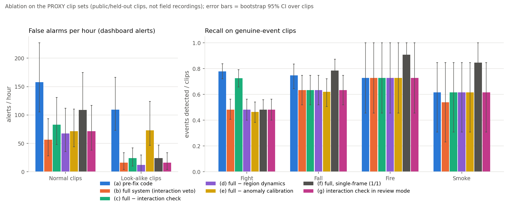
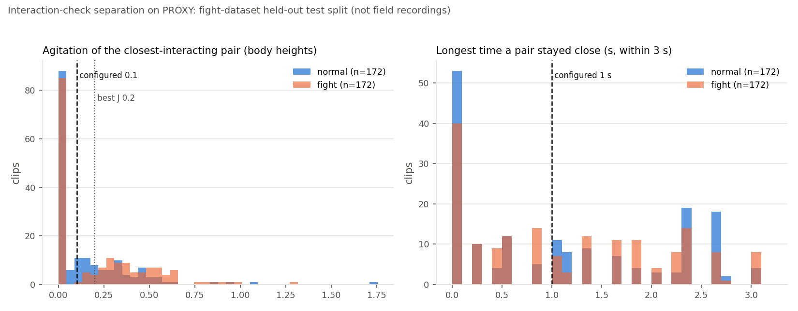

# Results

All numbers on this page are produced by scripts in
`perception-service/evaluation/` from files in the repository. None are typed
in by hand. Re-generate with:

```bash
cd perception-service
python -m evaluation.run_all              # model metrics, charts, model_results.json
python -m evaluation.false_alarms ...     # false alarms per hour on normal footage
python -m evaluation.benchmark ...        # FPS and per-stage latency
python -m evaluation.ablation run         # ablation of the verification stages (hours)
python -m evaluation.interaction_separation  # fight interaction-check thresholds
```

Section 6 (Ask DVS assistant) comes from `backend/scripts/eval-assistant.ts`
(`npm run eval:assistant` in `backend/`; needs the assistant API key and the
database).

<!-- BEGIN:models -->
## 1. Model metrics

Generated by `python -m evaluation.run_all` from `perception-service/models/*.json`.
**Role:** *final* = the model the live pipeline uses; *baseline* = what it replaced or is compared against; *alternative* = evaluated but not deployed. Test-set size is the number of test videos (or pose windows for the pose-LSTM). False alarms = false positives on that test set. Protocols differ per task, so compare rows only within a task.

| Task | Model | Role | Precision | Recall | F1 | AUC | False alarms | Test size | Protocol |
|---|---|---|---|---|---|---|---|---|---|
| Fight | R3D-18 v1 | baseline | 0.93 | 0.78 | 0.85 | 0.91 | 10 | 344 | test split, live rule: 5 clips/video, 2 of 3 consecutive clips >= threshold |
| Fight | R3D-18 v2 (deployed) | final | 0.94 | 0.97 | 0.96 | 0.99 | 10 | 344 | test split, live rule: 5 clips/video, 2 of 3 consecutive clips >= threshold |
| Fight | R3D-18 v1, single clip | baseline | 0.82 | 0.72 | 0.76 | – | 27 | 344 | test split, one clip per video |
| Fight | R3D-18 v2, 3-clip mean | final | 0.94 | 0.97 | 0.95 | 0.99 | 11 | 344 | test split, mean of 3 clips per video |
| Fight | Pose-LSTM v1 (not deployed) | alternative | 0.82 | 0.95 | 0.88 | – | 46 | 386 | test split of pose windows |
| Fight | Pose-LSTM v2 | alternative | 0.83 | 0.79 | 0.81 | – | 46 | 455 | test split of pose windows |
| Fall | Box rule, as deployed (5 s still) | baseline | 0.56 | 0.06 | 0.11 | – | 4 | 160 | 160 videos, 5-fold cross-validation grouped by event (out-of-fold scores) |
| Fall | Box rule, relaxed (1 s) | baseline | 0.80 | 0.82 | 0.81 | – | 16 | 160 | 160 videos, 5-fold cross-validation grouped by event (out-of-fold scores) |
| Fall | Pose + BiGRU (deployed) | final | 0.86 | 0.94 | 0.90 | 0.96 | 12 | 160 | 160 videos, 5-fold cross-validation grouped by event (out-of-fold scores) |
| Fall | Pose features + Random Forest | alternative | 0.86 | 0.94 | 0.90 | 0.95 | 12 | 160 | 160 videos, 5-fold cross-validation grouped by event (out-of-fold scores) |
| Fall | Pose features + Gradient Boosting | alternative | 0.86 | 0.92 | 0.89 | 0.95 | 12 | 160 | 160 videos, 5-fold cross-validation grouped by event (out-of-fold scores) |
| Fall | Pose features + Logistic Regression | alternative | 0.86 | 0.87 | 0.87 | 0.94 | 11 | 160 | 160 videos, 5-fold cross-validation grouped by event (out-of-fold scores) |
| Fall | Physics score (no training) | alternative | 0.86 | 0.78 | 0.82 | – | 10 | 160 | 160 videos, 5-fold cross-validation grouped by event (out-of-fold scores) |
| Fire | YOLOv8n fire only | baseline | 0.83 | 0.91 | 0.87 | – | 2 | 27 | FIRESENSE fire videos (27), leave-one-video-out |
| Fire | YOLOv8n + learned verifier (deployed) | final | 1.00 | 0.91 | 0.95 | – | 0 | 27 | FIRESENSE fire videos (27), leave-one-video-out |
| Smoke | YOLOv8n smoke only | baseline | 1.00 | 0.85 | 0.92 | – | 0 | 22 | FIRESENSE smoke videos (22), leave-one-video-out |
| Smoke | YOLOv8n + learned verifier (deployed) | final | 1.00 | 0.85 | 0.92 | – | 0 | 22 | FIRESENSE smoke videos (22), leave-one-video-out |
| Fire | YOLOv8n, stricter thresholds (rejected) | alternative | 1.00 | 0.45 | 0.62 | – | 0 | 27 | FIRESENSE fire videos (27) |
| Smoke | YOLOv8n, stricter thresholds (rejected) | alternative | 0.92 | 0.85 | 0.88 | – | 1 | 22 | FIRESENSE smoke videos (22) |
| Unusual activity | Autoencoder v1 | baseline | 0.83 | 0.38 | 0.52 | 0.74 | 3 | 60 | unseen normal + fall videos, alert if 2 consecutive 2-s windows exceed the threshold |
| Unusual activity | Autoencoder v2 (deployed) | final | 0.96 | 0.67 | 0.79 | 0.84 | 2 | 102 | unseen normal + fall videos, alert if 2 consecutive 2-s windows exceed the threshold |

Notes:

- Fight / Pose-LSTM v1 (not deployed): different test set (pose windows); not deployed, code removed.
- Fight / Pose-LSTM v2: different test set (pose windows); not deployed, code removed.
- Fall / Box rule, relaxed (1 s): generous version: omits the rule's 8-px stillness check.
- Fire / YOLOv8n, stricter thresholds (rejected): fire 0.7 / smoke 0.45: lost recall, so not adopted.
- Smoke / YOLOv8n, stricter thresholds (rejected): fire 0.7 / smoke 0.45: lost recall, so not adopted.
- Unusual activity / Autoencoder v1: split by file (camera angles of one event could leak); 40 abnormal test videos.
- Unusual activity / Autoencoder v2 (deployed): split by event; 79 abnormal test videos.
- AUC is left blank where the file stores none (rules, thresholded baselines).
- Fire/smoke rows are video-level detection with YOLO persistence (3 of 5 sampled frames); the YOLOv8n detector's own image-level confusion matrix is `perception-service/models/fire_smoke_yolov8n_v1.confusion_matrix.png`.

Source of every row (file and key):

- Fight / R3D-18 v1: `fight_r3d18_v2.runtime.json compared_with.test_live_rule`
- Fight / R3D-18 v2 (deployed): `fight_r3d18_v2.runtime.json model.test_live_rule`
- Fight / R3D-18 v1, single clip: `fight_r3d18_v1.metrics.json test`
- Fight / R3D-18 v2, 3-clip mean: `fight_r3d18_v2.metrics.json test`
- Fight / Pose-LSTM v1 (not deployed): `fight_lstm.metrics.json test`
- Fight / Pose-LSTM v2: `fight_lstm_v2.metrics.json test`
- Fall / Box rule, as deployed (5 s still): `fall_gru_v1.metrics.json rule_baseline_deployed_5s`
- Fall / Box rule, relaxed (1 s): `fall_gru_v1.metrics.json rule_baseline_relaxed_1s`
- Fall / Pose + BiGRU (deployed): `fall_gru_v1.metrics.json pose_gru_model`
- Fall / Pose features + Random Forest: `fall_rf_v1.metrics.json models.random_forest`
- Fall / Pose features + Gradient Boosting: `fall_rf_v1.metrics.json models.gradient_boosting`
- Fall / Pose features + Logistic Regression: `fall_rf_v1.metrics.json models.logistic_regression`
- Fall / Physics score (no training): `fall_rf_v1.metrics.json baselines['physics_score (no training)']`
- Fire / YOLOv8n fire only: `fire_smoke_verifier_v1.metrics.json fire.yolo_only`
- Fire / YOLOv8n + learned verifier (deployed): `fire_smoke_verifier_v1.metrics.json fire.yolo_plus_verifier`
- Smoke / YOLOv8n smoke only: `fire_smoke_verifier_v1.metrics.json smoke.yolo_only`
- Smoke / YOLOv8n + learned verifier (deployed): `fire_smoke_verifier_v1.metrics.json smoke.yolo_plus_verifier`
- Fire / YOLOv8n, stricter thresholds (rejected): `fire_smoke_calibration_v2.rejected.summary.json fire`
- Smoke / YOLOv8n, stricter thresholds (rejected): `fire_smoke_calibration_v2.rejected.summary.json smoke`
- Unusual activity / Autoencoder v1: `scene_anomaly_ae_v1.metrics.json video_level`
- Unusual activity / Autoencoder v2 (deployed): `scene_anomaly_ae_v2.metrics.json video_level`

Files not used:

- `fight_r3d18_smoke.metrics.json`: pipeline smoke test on 10 clips, not an evaluation
- `fight_r3d18_unfreeze_smoke.metrics.json`: pipeline smoke test on 10 clips, not an evaluation
- `fight_r3d18_v1_baseline.metrics.json`: identical copy of fight_r3d18_v1.metrics.json
- `fight_lstm_baseline_v1.metrics.json`: identical copy of fight_lstm.metrics.json
- `fight_lstm_v1_window_model.metrics.json`: identical copy of fight_lstm.metrics.json
- `fight_lstm_v2_baseline.metrics.json`: identical copy of fight_lstm_v2.metrics.json
- `fire_smoke_video_eval_baseline.summary.json`: same YOLO-only evaluation as the verifier file's yolo_only rows (identical counts)
- `scene_anomaly_ae_v3_factory.metrics.json`: factory-footage model, reported in section 7 by anomaly.train_factory (different protocol)

### Bootstrap 95% confidence intervals

Percentile bootstrap, 1000 resamples over test videos, fixed seed (`evaluation/stats.py`). Only rows whose per-video predictions are stored in the repository can be resampled; the recomputed confusion counts equal the stored ones.

| Task | Model | n | Precision | Recall | F1 | AUC | Per-video source |
|---|---|---|---|---|---|---|---|
| Fire | YOLOv8n fire only | 27 | 0.83 [0.60, 1.00] | 0.91 [0.71, 1.00] | 0.87 [0.70, 1.00] | – | `fire_smoke_video_eval_baseline.results.csv` |
| Smoke | YOLOv8n smoke only | 22 | 1.00 [1.00, 1.00] | 0.85 [0.64, 1.00] | 0.92 [0.78, 1.00] | – | `fire_smoke_video_eval_baseline.results.csv` |
| Unusual activity | Autoencoder v1 | 60 | 0.83 [0.65, 1.00] | 0.38 [0.24, 0.52] | 0.52 [0.37, 0.65] | 0.74 [0.60, 0.87] | `scene_anomaly_ae_v1.per_video.json` |
| Unusual activity | Autoencoder v2 (deployed) | 102 | 0.96 [0.91, 1.00] | 0.67 [0.57, 0.77] | 0.79 [0.71, 0.86] | 0.84 [0.72, 0.93] | `scene_anomaly_ae_v2.per_video.json` |

No interval (per-video predictions not stored; not approximated):

- Fight / R3D-18 v1: the metrics files store only aggregate confusion counts, no per-video predictions.
- Fight / R3D-18 v2 (deployed): the metrics files store only aggregate confusion counts, no per-video predictions.
- Fight / R3D-18 v1, single clip: the metrics files store only aggregate confusion counts, no per-video predictions.
- Fight / R3D-18 v2, 3-clip mean: the metrics files store only aggregate confusion counts, no per-video predictions.
- Fight / Pose-LSTM v1 (not deployed): the metrics files store only aggregate confusion counts, no per-video predictions.
- Fight / Pose-LSTM v2: the metrics files store only aggregate confusion counts, no per-video predictions.
- Fall / Box rule, as deployed (5 s still): only aggregate out-of-fold counts are stored.
- Fall / Box rule, relaxed (1 s): only aggregate out-of-fold counts are stored.
- Fall / Pose + BiGRU (deployed): only aggregate out-of-fold counts are stored.
- Fall / Pose features + Random Forest: only aggregate out-of-fold counts are stored.
- Fall / Pose features + Gradient Boosting: only aggregate out-of-fold counts are stored.
- Fall / Pose features + Logistic Regression: only aggregate out-of-fold counts are stored.
- Fall / Physics score (no training): only aggregate out-of-fold counts are stored.
- Fire / YOLOv8n + learned verifier (deployed): only aggregate leave-one-video-out counts are stored.
- Smoke / YOLOv8n + learned verifier (deployed): only aggregate leave-one-video-out counts are stored.
- Fire / YOLOv8n, stricter thresholds (rejected): per-video lines exist only in an untracked local log, not in the repo.
- Smoke / YOLOv8n, stricter thresholds (rejected): per-video lines exist only in an untracked local log, not in the repo.

Paired significance tests (exact McNemar):

- fight_v1_vs_v2: not computed: per-video predictions of R3D-18 v1 and v2 are not stored (only confusion counts), so the paired test cannot be computed.
- autoencoder_v1_vs_v2: not computed: v1 and v2 were tested on different video sets (60 vs 102 videos, split by file vs by event), so their predictions are not paired.

### Figures


*Deployed model per task: precision, recall and F1.*


*Baseline vs final model: F1 and false alarms.*


*Confusion matrices of the final models (and fight v1).*
<!-- END:models -->

<!-- BEGIN:false_alarms -->
## 2. False alarms per hour on normal footage

**Not measured yet: no long normal-activity recording is available.** The
longest normal clip in the local datasets is 30 s, which is too short for a
per-hour rate, and the scene-anomaly detector needs 5 minutes of calibration
first. No number is reported here until it is measured.

The measurement is ready to run. Record 10-15 minutes of ordinary activity
from the demo camera (people walking, sitting, talking, working; no fights,
falls, fire, crowds of 4+ or loitering in the restricted zone), then:

```bash
cd perception-service
python -m evaluation.false_alarms --video <recording>.mp4
```

It plays the recording through the current code (records tagged
`validation_version: 2`) and through the code before the false-positive fixes
(commit `85315cc~1`, checked out in a temporary git worktree), with the
dashboard and LLM switched off, and replaces this section with a
before/after table of incidents per hour by type.

What the fixes changed, by root cause, is described in
[perception-service/docs/FALSE_POSITIVE_FIXES.md](../perception-service/docs/FALSE_POSITIVE_FIXES.md);
the 26 normal-activity and genuine-event scenarios in
`perception-service/test_false_positives.py` pass.
<!-- END:false_alarms -->

<!-- BEGIN:benchmark -->
## 3. Speed: frames per second and per-stage latency

Generated by `python -m evaluation.benchmark` on 2026-10-15: 100 s of the demo playlist per device, paced at 10 processed frames/s as in live use, 640×480 processing resolution.

Hardware: Intel64 Family 6 Model 186 Stepping 2, GenuineIntel; GPU: NVIDIA GeForce RTX 3050 A Laptop GPU; Windows-11-10.0.26200-SP0; Python 3.12.8, PyTorch 2.5.1+cu121.

| Stage | GPU ms per frame | CPU ms per frame |
|---|---|---|
| YOLOv8n person/object detection | 19.8 | 61.7 |
| ByteTrack tracking | 0.4 | 0.3 |
| Rule engine (loitering, intrusion, crowd) | 0.1 | 0.1 |
| Fight (R3D-18 + interaction) | 7.2 | 19.0 |
| Fire/smoke (YOLOv8n + verifier) | 11.0 | 28.6 |
| Fall (YOLOv8-Pose + BiGRU) | 8.1 | 40.6 |
| Unusual activity (optical flow + autoencoder) | 2.9 | 2.1 |
| Whole frame | 51.9 | 153.8 |

| | GPU | CPU |
|---|---|---|
| Processed frames/s achieved (target 10) | 9.2 | 6.1 |
| Capacity, frames/s (1000 / ms per frame) | 19.3 | 6.5 |

ms per frame = average time the stage adds to each processed frame. The fight, fire/smoke, fall and unusual-activity detectors run their model only on a stride or when their gate opens, so one inference takes longer than the average shown. "Whole frame" also includes resizing and evidence buffering; video decoding is not included. Timings depend on what is in view (the fight and fall models only run when people are present).
<!-- END:benchmark -->

<!-- BEGIN:ablation -->
## 4. Ablation study

Generated by `python -m evaluation.ablation` (runs 2026-10-15, 2026-10-22, 2026-10-23). Footage: **proxy clip sets (held-out/public clips in perception-service/data; field recordings unavailable)**. Every clip is played separately through the real pipeline at the live 10 processed frames/s, headless, dashboard and LLM off, zones removed. Counts are dashboard alerts (CONFIRMED, or PROBABLE later escalated); fights sent for operator review in (g) and (h) are counted separately below. Brackets: bootstrap 95% CI over clips (1000 resamples). Per-clip outcomes: `docs/results/ablation_per_clip/`.

**These are proxy sets, not field recordings.** The deployment-camera recordings (normal activity, staged events, look-alikes) were not available, so the rows below use short clips from many different cameras. False-alarm rates are therefore rates on *clips of other people's cameras*, and the per-camera anomaly calibration is computed from a pool of such clips rather than from one camera. Treat the numbers as evidence about the direction of each stage's effect, not as deployment rates.

| Set | Clips | Minutes | Source |
|---|---|---|---|
| normal | 172 | 16.0 | fight-dataset test split, not-fight clips (held out from every model) |
| lookalikes | 25 | 14.8 | FIRESENSE fire/neg + smoke/neg clips (fire/smoke look-alike scenes) |
| fight | 172 | 15.2 | fight-dataset test split, fight clips (held out) |
| fall | 79 | 9.0 | fall dataset, fall clips (IN-SAMPLE: the deployed fall GRU was trained on them) |
| fire | 11 | 5.6 | FIRESENSE fire/pos clips (verifier trained on FIRESENSE) |
| smoke | 13 | 8.8 | FIRESENSE smoke/pos clips (verifier trained on FIRESENSE) |

### False alarms per hour

| Configuration | Normal: total / h | Normal: by type | Look-alikes: total / h | Look-alikes: by type |
|---|---|---|---|---|
| (a) pre-fix code | 42 alarms = 157.9 [105.3, 226.9] | anomaly 2 (7.5/h), crowd 3 (11.3/h), fall 23 (86.5/h), fight 14 (52.6/h) | 27 alarms = 109.5 [72.7, 166.3] | anomaly 14 (56.8/h), crowd 2 (8.1/h), fall 7 (28.4/h), fight 4 (16.2/h) |
| (b) full system (interaction veto) | 15 alarms = 56.4 [28.0, 93.3] | fall 5 (18.8/h), fight 9 (33.8/h), fire_smoke 1 (3.8/h) | 4 alarms = 16.2 [4.0, 33.6] | fall 2 (8.1/h), fight 2 (8.1/h) |
| (c) full − interaction check | 22 alarms = 82.7 [47.8, 130.8] | fall 6 (22.6/h), fight 15 (56.4/h), fire_smoke 1 (3.8/h) | 6 alarms = 24.3 [10.3, 42.1] | fall 2 (8.1/h), fight 4 (16.2/h) |
| (d) full − region dynamics | 18 alarms = 67.7 [35.7, 111.6] | crowd 1 (3.8/h), fall 6 (22.6/h), fight 11 (41.4/h) | 3 alarms = 12.2 [0.0, 29.5] | fall 1 (4.0/h), fight 2 (8.1/h) |
| (e) full − anomaly calibration | 19 alarms = 71.4 [43.9, 110.2] | anomaly 2 (7.5/h), crowd 1 (3.8/h), fall 6 (22.6/h), fight 10 (37.6/h) | 18 alarms = 73.0 [46.4, 123.6] | anomaly 14 (56.8/h), fall 2 (8.1/h), fight 2 (8.1/h) |
| (f) full, single-frame (1/1) | 29 alarms = 109.0 [61.3, 174.5] | crowd 1 (3.8/h), fall 10 (37.6/h), fight 14 (52.6/h), fire_smoke 4 (15.0/h) | 6 alarms = 24.3 [9.9, 47.1] | fall 2 (8.1/h), fight 2 (8.1/h), fire_smoke 2 (8.1/h) |
| (g) interaction check in review mode | 19 alarms = 71.4 [38.2, 116.6] | crowd 1 (3.8/h), fall 6 (22.6/h), fight 11 (41.4/h), fire_smoke 1 (3.8/h) | 4 alarms = 16.2 [4.0, 33.6] | fall 2 (8.1/h), fight 2 (8.1/h) |
| (h) deployed, after false-positive tuning | 10 alarms = 37.6 [15.7, 69.2] | fall 3 (11.3/h), fight 6 (22.6/h), fire_smoke 1 (3.8/h) | 4 alarms = 16.2 [4.0, 33.6] | fall 2 (8.1/h), fight 2 (8.1/h) |

### Recall on genuine events (events detected / clips)

| Configuration | fight | fall | fire | smoke |
|---|---|---|---|---|
| (a) pre-fix code | 134/172 = 0.78 [0.72, 0.84] | 59/79 = 0.75 [0.65, 0.84] | 8/11 = 0.73 [0.45, 1.00] | 8/13 = 0.62 [0.31, 0.85] |
| (b) full system (interaction veto) | 83/172 = 0.48 [0.41, 0.56] | 50/79 = 0.63 [0.52, 0.75] | 8/11 = 0.73 [0.45, 1.00] | 7/13 = 0.54 [0.23, 0.85] |
| (c) full − interaction check | 125/172 = 0.73 [0.66, 0.79] | 50/79 = 0.63 [0.52, 0.75] | 8/11 = 0.73 [0.45, 1.00] | 8/13 = 0.62 [0.31, 0.85] |
| (d) full − region dynamics | 83/172 = 0.48 [0.40, 0.56] | 50/79 = 0.63 [0.52, 0.75] | 8/11 = 0.73 [0.45, 1.00] | 8/13 = 0.62 [0.31, 0.85] |
| (e) full − anomaly calibration | 80/172 = 0.47 [0.38, 0.54] | 49/79 = 0.62 [0.51, 0.72] | 8/11 = 0.73 [0.45, 1.00] | 8/13 = 0.62 [0.31, 0.85] |
| (f) full, single-frame (1/1) | 83/172 = 0.48 [0.41, 0.56] | 62/79 = 0.78 [0.68, 0.87] | 10/11 = 0.91 [0.73, 1.00] | 11/13 = 0.85 [0.62, 1.00] |
| (g) interaction check in review mode | 83/172 = 0.48 [0.40, 0.56] | 50/79 = 0.63 [0.52, 0.75] | 8/11 = 0.73 [0.45, 1.00] | 8/13 = 0.62 [0.31, 0.85] |
| (h) deployed, after false-positive tuning | 80/172 = 0.47 [0.39, 0.55] | 49/79 = 0.62 [0.52, 0.72] | 8/11 = 0.73 [0.45, 1.00] | 7/13 = 0.54 [0.23, 0.85] |

### Paired differences against the full system

Every configuration ran on the same clips, so each is compared with (b) clip by clip: the same bootstrap resample of clips is applied to both. False alarms: alarms per hour, configuration minus full (positive = more false alarms without the stage). Recall: configuration minus full (positive = the stage was costing detections). An interval that excludes 0 marks a difference larger than resampling noise.

| Configuration | Δ FA/h normal | Δ FA/h lookalikes | Δ recall fight | Δ recall fall | Δ recall fire | Δ recall smoke |
|---|---|---|---|---|---|---|
| (a) pre-fix code | +101.5 [+66.5, +148.9] | +93.2 [+58.8, +143.4] | +0.30 [+0.23, +0.37] | +0.11 [+0.05, +0.19] | +0.00 [+0.00, +0.00] | +0.08 [+0.00, +0.23] |
| (c) full − interaction check | +26.3 [+9.4, +51.3] | +8.1 [+0.0, +19.5] | +0.24 [+0.17, +0.32] | +0.00 [+0.00, +0.00] | +0.00 [+0.00, +0.00] | +0.08 [+0.00, +0.23] |
| (d) full − region dynamics | +11.3 [-3.8, +31.7] | -4.0 [-10.1, +0.0] | +0.00 [-0.02, +0.02] | +0.00 [+0.00, +0.00] | +0.00 [+0.00, +0.00] | +0.08 [+0.00, +0.23] |
| (e) full − anomaly calibration | +15.0 [-4.6, +30.2] | +56.8 [+35.3, +96.3] | -0.02 [-0.04, +0.00] | -0.01 [-0.04, +0.00] | +0.00 [+0.00, +0.00] | +0.08 [+0.00, +0.23] |
| (f) full, single-frame (1/1) | +52.6 [+22.4, +96.2] | +8.1 [+0.0, +22.7] | +0.00 [-0.02, +0.02] | +0.15 [+0.08, +0.24] | +0.18 [+0.00, +0.45] | +0.31 [+0.08, +0.54] |
| (g) interaction check in review mode | +15.0 [+3.1, +33.0] | +0.0 [+0.0, +0.0] | +0.00 [-0.02, +0.02] | +0.00 [+0.00, +0.00] | +0.00 [+0.00, +0.00] | +0.08 [+0.00, +0.23] |
| (h) deployed, after false-positive tuning | -18.8 [-41.2, -3.9] | +0.0 [+0.0, +0.0] | -0.02 [-0.04, +0.00] | -0.01 [-0.04, +0.00] | +0.00 [+0.00, +0.00] | +0.00 [+0.00, +0.00] |

### Fights sent for operator review

In review mode a fight whose interaction check fails (and in (h) also one whose scores stay below the alarm threshold) is still reported, as PROBABLE ("Possible fight — please check", no pop-up). Those are not alerts in the tables above; this table counts them. Recall including review = clips with a fight alert or a fight sent for review. Deltas are paired against (b), the veto.

| Configuration | Review alerts, normal | Review alerts, look-alikes | Fight recall (alerts) | Fight recall incl. review | Δ fight recall incl. review vs (b) | Δ FA/h normal incl. review vs (b) |
|---|---|---|---|---|---|---|
| (g) interaction check in review mode | 3 = 11.3 [0.0, 26.2] / h | 2 = 8.1 [0.0, 19.5] / h | 83/172 = 0.48 [0.40, 0.56] | 129/172 = 0.75 [0.69, 0.81] | +0.27 [+0.20, +0.34] | +26.3 [+9.3, +50.5] |
| (h) deployed, after false-positive tuning | 6 = 22.6 [7.4, 46.0] / h | 2 = 8.1 [0.0, 19.5] / h | 80/172 = 0.47 [0.39, 0.55] | 130/172 = 0.76 [0.70, 0.81] | +0.27 [+0.21, +0.34] | +3.8 [-12.8, +22.3] |

Processing pace in (b), wall-clock seconds per second of video (1.0 = real time): normal 1.96, lookalikes 1.26, fight 1.33, fall 1.27, fire 1.07, smoke 1.08. Wall time includes each clip's detector start-up (about a second), which dominates on the 5-s clips. The longest clip (lookalikes, 189 s) took 263 s of wall time.

Unusual-activity (anomaly) alarms raised while the genuine-event clips played (no labelled unusual-activity set exists in the proxy, so this is the only indication of what calibration costs in anomaly detections):

| Configuration | fight | fall | fire | smoke |
|---|---|---|---|---|
| (a) pre-fix code | 3 | 0 | 7 | 11 |
| (b) full system (interaction veto) | 0 | 0 | 0 | 0 |
| (c) full − interaction check | 0 | 0 | 0 | 0 |
| (d) full − region dynamics | 0 | 0 | 0 | 0 |
| (e) full − anomaly calibration | 3 | 0 | 7 | 11 |
| (f) full, single-frame (1/1) | 0 | 0 | 0 | 0 |
| (g) interaction check in review mode | 0 | 0 | 0 | 0 |
| (h) deployed, after false-positive tuning | 0 | 0 | 0 | 0 |

Configurations:

- (a) pre-fix code: code at `85315cc~1`, its own thresholds.yaml.
- (b) full system (interaction veto): `fight_detection.interaction.mode: veto`.
- (c) full − interaction check: `fight_detection.interaction.enabled: False`.
- (d) full − region dynamics: `fight_detection.interaction.mode: veto`, `fire_smoke_detection.dynamics.enabled: False`.
- (e) full − anomaly calibration: `fight_detection.interaction.mode: veto`, `scene_anomaly.calibration.enabled: False`.
- (f) full, single-frame (1/1): `fight_detection.interaction.mode: veto`, `fight_detection.rgb.persistence_window: 1`, `fight_detection.rgb.required_confirmed: 1`, `fire_smoke_detection.persistence_window: 1`, `fire_smoke_detection.required_hits: 1`, `fire_smoke_detection.single_class_confirm_seconds: 0`, `fall_detection.gru.persistence_window: 1`, `fall_detection.gru.required_hits: 1`, `scene_anomaly.persistence_window: 1`, `scene_anomaly.required_hits: 1`, `confirmation.default.probable_hits: 1`, `confirmation.default.probable_window: 1`, `confirmation.default.confirmed_hits: 1`, `confirmation.default.confirmed_window: 1`.
- (g) interaction check in review mode: `fight_detection.interaction.mode: review`.
- (h) deployed, after false-positive tuning: current thresholds.yaml.

Scene-anomaly calibration used by the calibrated configurations: 51 windows pooled from 172 normal clips disjoint from the evaluation sets (fight-dataset validation split); 99th-percentile ratio 8.733 → camera threshold 8.733× the model's.

Caveats: one run per configuration (the pipeline is timing-dependent, so a re-run can differ by an alert or a detection); clip-level recall counts a clip as detected if at least one dashboard alert of the right type was raised while it played; alerts of other types on event clips are not counted as false alarms.



*Ablation: false alarms per hour (left) and recall (right) per configuration, 95% bootstrap CIs.*
<!-- END:ablation -->

<!-- BEGIN:interaction -->
## 5. Fight interaction-check thresholds

Generated by `python -m evaluation.interaction_separation` on 2026-10-15. Clips: **PROXY: fight-dataset held-out test split (not field recordings)** (172 fight, 172 normal). Values are measured with the live detector, tracker and `temporal/interaction.py` at every processed frame (video time instead of wall-clock). Brackets: bootstrap 95% CI over clips (1000 resamples).

| Quantity | Fight clips (median) | Normal clips (median) | ROC AUC |
|---|---|---|---|
| agitation of a close pair (body heights) | 0.123 | 0.034 | 0.55 [0.50, 0.61] |
| longest close_seconds | 1.00 | 1.00 | 0.52 |

| Agitation threshold | Fight clips passing | Normal clips passing | Youden J |
|---|---|---|---|
| 0.1 (configured) | 0.51 [0.44, 0.57] | 0.42 [0.34, 0.50] | 0.08 [-0.02, 0.19] |
| 0.2 (best J on these clips) | 0.47 [0.39, 0.54] | 0.29 [0.22, 0.36] | 0.17 [0.08, 0.28] |

Closeness alone (close_seconds >= 1 s): fight clips 0.51, normal clips 0.51.

Difference in J, best minus configured: [0.04, 0.15] (the best threshold is chosen on these same clips, so this is optimistic). **On these clips the best-J threshold is better.** Both are reported; the configured 0.1 is kept because the better value was chosen on the same clips, they are proxy clips from other cameras rather than the deployment camera, and the ablation (section 4) runs at 0.1. Re-check on field recordings before changing it.

Pass rates are for the check on its own at every frame. In the pipeline it only runs after the R3D-18 2-of-3 rule fires, so these are upper bounds on how often it lets an alert through.



*Distribution of agitation (left) and close time (right) for fight vs normal clips; dashed = configured threshold.*
<!-- END:interaction -->

## 6. Ask DVS assistant

<!-- BEGIN:assistant -->
Generated 2026-10-17 by `backend/scripts/eval-assistant.ts` with `openai/gpt-oss-20b`; per-question answers in [results/assistant_eval.json](results/assistant_eval.json).

40 questions: 30 data questions (stock, forecast, purchase and client orders, suppliers, production, attendance, incidents, plant health), 5 out-of-scope questions and 5 requests to change data. Expected facts are computed from the database at run time, independently of the assistant's tools. The baseline is the same model and system prompt answering from the question alone.

| Metric | Ask DVS (tools + grounding) | No-tools baseline |
|---|---|---|
| Tool-selection accuracy (40) | 95% (38/40) | n/a |
| Answer correctness (30 data questions) | 86.7% (26/30) | 10% (3/30) |
| Grounded answers (30 data questions) | 100% (30/30) | 96.7% (29/30) |
| Refusal correctness (10) | 100% (out of scope 5/5, change requests 5/5) | 100% (out of scope 5/5, change requests 5/5) |
| Median latency | 1372 ms | 692 ms |
| Errors | 0 | 0 |

Database at run time: 1 material(s), 1 supplier(s), 3 purchase order(s), 3 client order(s), 136 open incident(s), 0 unit(s) produced this week, 0 employee(s) in today's attendance. Many expected answers are therefore "none" or 0; re-run on a fuller database for a stronger test.

A baseline answer counts as grounded only if it contains no numbers beyond those in the question and the date. Latency excludes waits for the provider's rate limit.
<!-- END:assistant -->

## 7. Unusual activity on the factory's own footage (v3)

Generated by `python -m anomaly.train_factory` from recordings of the company's
own cameras (`models/scene_anomaly_ae_v3_factory.metrics.json`). The footage is
company data and is not in the repository.

**Data.** 4 recordings from 3 cameras were long enough to use
(6.25 minutes, 937 two-second windows after the background-model
warm-up); 8 clips were shorter than about 26 s (too short for five time blocks) and were not used.

**Protocol.** Blocked 5-fold cross-validation in time: each recording is cut
into 5 consecutive blocks, each fold tests on one block it never saw, with a
gap around held-out blocks so overlapping windows cannot leak. Model size was
chosen on the validation blocks only. The live per-camera calibration is
simulated (camera threshold = p99 of that camera's other blocks). v2 is
scored on exactly the same windows with the same calibration.

**Fit (not underfitting; some overfitting on rare activity).** Chosen size 24-6
(hidden-bottleneck), input noise 0.1. Typical windows fit equally well on
training and held-out blocks (median error 0.00045 vs 0.00046), and smaller
models have higher held-out error (16-6: 0.00059, 8-4: 0.00104), so the model
is not too small. The mean error, which the busy, less common windows
dominate, is 0.025 on training blocks but 0.165 on held-out blocks (6.6×):
the model reconstructs the activity it saw better than similar activity it
did not see. With 6 minutes of footage that is expected; it is also where
the false alerts below come from.

| On 6.25 min of held-out normal footage | v3 (factory) | v2 (public videos) |
|---|---|---|
| Windows above threshold | 2.6% | 0.8% |
| False alert episodes | 5 | 1 |
| SYNTHETIC: fast motion ×4 detected | 1/20 | 0/20 |
| SYNTHETIC: camera covered detected | 20/20 | 20/20 |
| SYNTHETIC: camera shake detected | 20/20 | 20/20 |
| SYNTHETIC: lights dimmed detected | 20/20 | 20/20 |

False alert episodes of v3 by camera: camA_press 3 in 3.61 min, camB_aisle 2 in 1.03 min, camC_hall 0 in 1.61 min.
They came from workers bending or passing close to the camera (silhouette-shape
features), not from real incidents.

**Decision: v2 stays the live model.** With about 6 minutes of footage, the
factory-trained model raised more false alerts than v2 and did not detect more
of the synthetic events. v3 is kept (`models/scene_anomaly_ae_v3_factory.npz`)
and becomes worth switching to once there are 20–60 minutes of continuous
normal footage per camera: re-run the same command and compare again.

The synthetic events are transformations of held-out footage, not recorded
incidents; no recordings of real incidents in this factory were available.
