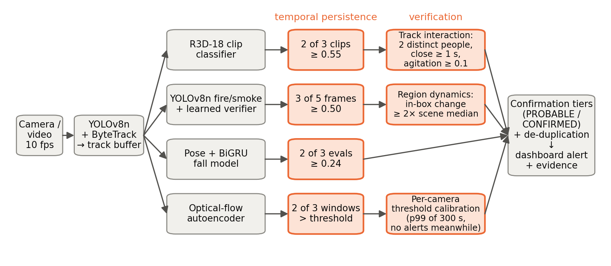

# Do Verification Stages Reduce CCTV False Alarms Without Losing Events? An End-to-End Ablation of a Multi-Event Industrial Surveillance Pipeline

*Sanchi Gangurde* — *[affiliation, department, institute, city, India — verify]* — aimms.pid4@gmail.com

---

**Abstract** — Automatic CCTV incident detection is only useful if its alarms are trusted, and trust is lost through false alarms per hour of ordinary footage, a quantity rarely measured. We study a multi-event industrial pipeline (fight, fall, fire/smoke, unusual activity) to which four training-free verification stages were added: N-of-M temporal persistence, a track-level interaction check for fights, a region-dynamics check for fire and smoke, and per-camera calibration of an anomaly threshold. We ablate each stage end to end, replaying 472 clips in real time through the unchanged production pipeline, and report bootstrap 95% confidence intervals. The deployment-camera recordings were unavailable, so the study uses held-out and public clips as a labelled proxy. Together the stages cut false alarms on fire look-alike scenes from 109.5 to 44.6 per hour, but on normal clips only from 157.9 to 135.3 per hour (the paired interval touches zero), and they lower fight recall from 0.78 to 0.47. Per stage, persistence and anomaly calibration remove most false alarms. The fight interaction check costs 0.28 recall for a marginal gain, calibration also silenced the anomaly detector on genuine events, and region dynamics had no measurable effect. The claim that verification reduces false alarms while keeping recall holds only in part. We report what each stage costs and what remains to be measured on site.

**Index Terms** — video surveillance, false alarms, fight detection, fire detection, fall detection, anomaly detection, ablation study, industrial safety.

---

## I. Introduction

Factories record CCTV continuously, but nobody watches every camera. Automatic incident detection can close that gap only if staff trust its alerts. A detector with a 1 % per-window false-positive rate, evaluated ten times a second on several cameras, still produces many false alerts per hour. After enough false alerts, operators stop responding. Published detectors are usually evaluated on curated, trimmed clips with balanced classes. The measure that decides whether a deployed system is used is different: **false alarms per hour of ordinary footage, at a recall that still catches genuine events**.

We built a multi-event CCTV pipeline for a manufacturing ERP that detects fights (R3D-18 [4]), falls (YOLOv8-Pose [2], [13] with a temporal CNN and BiGRU [14]), fire and smoke (fine-tuned YOLOv8n [1], [2] with a learned verifier) and unusual activity (an optical-flow autoencoder, after [9]). On a real test camera, normal activity produced fight, smoke and "unusual activity" alerts every few minutes. Each detector was good on its own test set, but the deployed system was not usable. The failures had distinct causes: a clip classifier scoring people who merely stood close together, static orange objects passing a fire detector, and an anomaly threshold learned on another site's footage. Instead of retraining, we added cheap verification stages that use evidence the detectors ignore.

**Research question.** Does a multi-stage verification pipeline (temporal persistence, track-level interaction validation for fights, a region-dynamics check for fire and smoke, and per-camera anomaly calibration) reduce false alarms per hour on normal footage while keeping recall on genuine events, and what does each stage contribute?

**Contributions.**

- A **verification pipeline** of four training-free stages placed after the per-event models (Fig. 1). Each targets a specific failure: persistence for single-window spikes, an interaction check that requires two distinct, close and agitated tracked people before a fight alert, a region-dynamics check that rejects static fire/smoke look-alikes, and a per-camera percentile calibration of the anomaly threshold.
- An **ablation protocol on the unchanged live pipeline**. Every clip is replayed separately in real time through the production code. Configurations differ only in existing configuration flags, or, for the pre-verification baseline, in the code version (checked out from version control). Results are reported as false alarms per hour and clip-level recall, with bootstrap confidence intervals.
- **Per-stage evidence, including negative results**, on 472 held-out and public clips (a proxy: the deployment-camera recordings were unavailable). Persistence and calibration remove most false alarms; the interaction check costs more fight recall than it saves; calibration can silence the detector it calibrates; region dynamics is not exercised by public look-alikes. Every number is generated by a script from stored per-clip outcomes or metrics files.

## II. Related Work

**Object detection and tracking.** Single-stage detectors from YOLO [1] to the anchor-free Ultralytics YOLOv8 [2] give real-time person detection; ByteTrack [3] associates low-confidence boxes as well and so reduces identity switches under occlusion. Our interaction check depends on such stable track identities.

**Violence and fight detection.** Spatio-temporal 3D CNNs [4] pretrained on Kinetics [5] are the standard backbone for clip-level action classification. Surveillance fight datasets [6], [7] *[verify]* show that clip-level spatio-temporal models outperform per-frame detection for violence. These works report clip accuracy on trimmed datasets; they do not address what a clip classifier does on hours of untrimmed footage from a camera it was not trained on, which is where our false alarms came from. Grad-CAM [8] explains such models visually; we attach Grad-CAM maps to fight alerts as evidence for the human reviewer.

**Fire and smoke.** Colour models of flame pixels [11] and spatio-temporal flicker and dynamic-texture features [12] *[verify]* were developed to separate flames from flame-coloured objects. We use the same principle, that real flames and smoke *change*, as a verification stage after a learned detector rather than as the detector itself.

**Falls.** Pose estimation in a single-stage detector [13] provides skeletons; recurrent models such as the GRU [14] classify their temporal evolution.

**Anomaly detection.** Autoencoders trained on normal video flag high reconstruction error as abnormal [9]; weakly supervised methods on UCF-Crime [10] show how hard the problem is and how high false-alarm rates are on real surveillance footage. A threshold learned on training footage need not transfer to a new camera. We calibrate it per camera.

**Gap.** Most work studies one event type on curated data and reports per-clip metrics. A deployed system combines several event types on one stream, and its users experience false alarms per hour. We are not aware, within the literature surveyed here, of an ablation of post-hoc verification stages measured end to end through the live pipeline. Our survey is limited to the works cited.

## III. Method

Fig. 1 shows the pipeline. Frames are processed at 10 frames/s at 640×480. YOLOv8n detects people, and ByteTrack assigns track IDs whose box histories are kept in a 30-s temporal buffer. Four learned detectors read the frames and tracks. Their outputs pass through the verification stages and then an event-confirmation stage with PROBABLE and CONFIRMED tiers and de-duplication (one incident per ongoing event per camera). Only CONFIRMED incidents, or PROBABLE ones later escalated to CONFIRMED, reach the dashboard; we call these *alarms*.

*Fig. 1. Pipeline. Shaded boxes are the verification stages evaluated in the ablation; the thresholds shown are the deployed configuration.*

### A. Base detectors

- **Fight:** R3D-18 [4] on 16-frame clips sampled at 10 frames/s of real time, scored every 4 processed frames when a permissive motion gate is open.
- **Fire/smoke:** YOLOv8n fine-tuned on fire/smoke images, followed by a gradient-boosting verifier on flicker, colour, texture and upward-motion features of each box.
- **Fall:** YOLOv8n-Pose skeletons and boxes over 4-s windows, classified by a temporal CNN followed by a bidirectional GRU.
- **Unusual activity:** a denoising autoencoder on 38 optical-flow and appearance-change features per 2-s window; the score is reconstruction error divided by a threshold (the 95th percentile on normal training windows).

### B. Temporal persistence

Each detector alerts only when *N* of its last *M* evaluations are positive: 2 of 3 R3D-18 clips at score ≥ 0.55; 3 of 5 sampled frames at YOLO confidence ≥ 0.50 for fire/smoke; 2 of 3 fall-model evaluations; 2 of 3 anomaly windows. A single fire or smoke class must also stay active for 3 s. This suppresses isolated single-window spikes.

### C. Track-level interaction validation (fights)

A fight needs two people in physical contact. When the R3D-18 rule fires, the alert is kept only if the track buffer shows:

1. **Two distinct people:** tracks seen within the last 1 s, after dropping a track whose box overlaps an older one with IoU ≥ 0.7 (one person tracked twice).
2. **Closeness:** a pair whose centre distance, normalised by their mean box height, is ≤ 1.2 for at least 1 s (*close_seconds*) within the last 3 s.
3. **Agitation:** for the more active person of the pair, *agitation = (‖σ(r_x), σ(r_y)‖ + σ(w) + σ(h)) / median(h)*. Here *r* is the residual of the box centre around a quadratic fit over the 3-s window (walking follows a smooth path, so it leaves little residual), and *w* and *h* are box width and height. The pair must reach agitation ≥ 0.1 body heights.

Grappling people are often merged into one box, so a pair that qualified within the last 2 s stays valid.

### D. Region dynamics (fire and smoke)

Static look-alikes (an orange poster, a lamp, a grey wall) can pass both the YOLO detector and the persistence rule. When a fire or smoke box persists, we compare the median absolute grey-level change of the pixels inside the box with that of the rest of the frame. Two ratios are computed. *Flicker* uses frame-to-frame differences over the last 5 evaluated frames (flames). *Growth* compares the current frame with a reference frame 8–30 s old (drifting smoke). The alarm is kept only if either ratio is at least 2, with a noise floor of 1 grey level. Because the reference is the rest of the scene, sensor noise and auto-exposure changes, which shift every pixel together, cancel out. The check reuses frames already evaluated, so it adds no delay.

### E. Per-camera anomaly calibration

The autoencoder's threshold comes from its training footage. On a new camera, ordinary activity can exceed it continuously. For its first 300 s on a camera, the detector records the error ratio of every window and raises no alerts. It then sets a camera scale equal to the 99th percentile of those ratios, never below 1 (never more sensitive than the trained model), and stores it for later restarts.

## IV. Experimental Setup

### A. Model evaluation data

The fight model was trained on 2,300 fight and non-fight videos [7] *[verify sources]*, split by video into 1,612 train, 344 validation and 344 test. Thresholds were chosen on validation. The fall models used 160 staged videos (79 falls, 81 non-falls from 48 events) with 5-fold cross-validation grouped by event. The fire verifier used FIRESENSE [12] (27 fire and 22 smoke videos) with leave-one-video-out evaluation. The anomaly autoencoder v2 was trained on normal videos and tested on 23 unseen normal and 79 abnormal videos, split by event.

### B. Ablation data (proxy)

The study was designed around recordings from the deployment camera: 15–30 min of normal activity, staged falls, fights and fire/smoke, and fire look-alikes. **These recordings were not available**, so we built labelled proxy sets from clips already in the project (Table I). The normal set is the fight test split's not-fight half; none of the deployed models was trained on it. The proxy differs from the intended field study in two ways. First, its clips come from many cameras and last a few seconds each, so they do not reproduce a fixed camera watched for an hour. Second, three sets overlap model training: the fall clips were used to train the deployed fall model, and FIRESENSE was used to train the fire verifier. Recall on those sets is therefore in-sample for that model.

*Table I. Proxy clip sets for the ablation.*

| Set | Clips | Minutes | Source / note |
|---|---|---|---|
| Normal | 172 | 16.0 | fight-dataset test split, not-fight; no model trained on it |
| Look-alikes | 25 | 14.8 | FIRESENSE fire/smoke negatives |
| Fight | 172 | 15.2 | fight-dataset test split (held out) |
| Fall | 79 | 9.0 | in-sample for the deployed fall model |
| Fire | 11 | 5.6 | FIRESENSE positives (verifier trained on FIRESENSE) |
| Smoke | 13 | 8.8 | FIRESENSE positives (verifier trained on FIRESENSE) |

Per-camera calibration needs 300 s of one camera. In the proxy, we pooled the windows the real detector recorded while observing all 172 not-fight clips of the fight *validation* split (915 s), disjoint from all evaluation sets. The detector's own routine then computed the 99th percentile from that pool. A 5-s clip yields about one 2-s window after warm-up, so the pool holds only 51 windows, just above the detector's minimum of 50. We did not concatenate the clips, because the scene cuts would themselves look abnormal.

### C. Configurations and protocol

(a) the code before the verification stages were added (version-control commit `85315cc~1`, with its own configuration); (b) the full system; (c) full without the interaction check; (d) full without region dynamics; (e) full without anomaly calibration; (f) full with every N-of-M rule set to 1 of 1 and the 3-s fire/smoke sustain set to 0. Configurations (c)–(f) change configuration flags only. Every clip is played separately through the production `run()` function. Each clip starts with fresh tracker, detector, confirmation and de-duplication state, at the live pace of 10 processed frames/s, because the detectors use wall-clock time. The dashboard and LLM are off, and the demo camera's placeholder zones are removed, since they are polygons drawn for another room.

### D. Metrics

*False alarms per hour* = dashboard alarms on normal or look-alike clips × 60 / total footage minutes, reported per event type. *Recall* = event clips with at least one dashboard alarm of the matching type / event clips. All 95% confidence intervals are percentile bootstraps over videos (1,000 resamples, fixed seed). For model metrics, intervals are computed only where per-video predictions are stored; aggregate counts are never resampled. Hardware: Intel laptop CPU and an NVIDIA RTX 3050 laptop GPU.

## V. Results

### A. Per-model results

Table II lists the deployed model of each task on its own test protocol. Intervals are given only where per-video predictions are stored. For the fight, fall and verified fire/smoke rows only aggregate counts exist, so no interval is computed, and a McNemar test of fight v1 against v2 could not be run.

*Table II. Deployed models on held-out data (95% bootstrap CI where per-video predictions exist).*

| Task | Model | n | Precision | Recall | F1 | AUC |
|---|---|---|---|---|---|---|
| Fight | R3D-18 v2, live 2-of-3 rule | 344 | 0.94 | 0.97 | 0.96 | 0.99 |
| Fall | Pose + BiGRU (5-fold CV) | 160 | 0.86 | 0.94 | 0.90 | 0.96 |
| Fire | YOLOv8n + verifier (LOVO) | 27 | 1.00 | 0.91 | 0.95 | – |
| Fire | YOLOv8n only | 27 | 0.83 [0.60, 1.00] | 0.91 [0.71, 1.00] | 0.87 [0.70, 1.00] | – |
| Smoke | YOLOv8n + verifier (LOVO) | 22 | 1.00 | 0.85 | 0.92 | – |
| Unusual activity | Autoencoder v2 | 102 | 0.96 [0.91, 1.00] | 0.67 [0.57, 0.77] | 0.79 [0.71, 0.86] | 0.84 [0.72, 0.93] |

Baselines: the fight model's first version reached F1 0.85 and the box-rule fall detector F1 0.81. YOLO alone on fire reached F1 0.87 with 2 false alarms, against 0 with the verifier. With 27 videos, that difference is within the interval.

### B. Ablation

Table III and Fig. 2 give false alarms per hour and recall for each configuration. Table IV gives the paired difference of each configuration against the full system on the same clips.

*Table III. False alarms per hour (FA/h, 95% CI) and clip-level recall on the proxy sets.*

| Configuration | FA/h normal | FA/h look-alikes | Fight | Fall | Fire | Smoke |
|---|---|---|---|---|---|---|
| (a) pre-fix code | 157.9 [105.3, 226.9] | 109.5 [72.7, 166.3] | 0.78 | 0.75 | 0.73 | 0.62 |
| (b) full system | 135.3 [81.0, 210.8] | 44.6 [25.4, 69.8] | 0.47 | 0.75 | 0.73 | 0.62 |
| (c) − interaction | 139.1 [85.2, 214.4] | 56.8 [33.6, 86.7] | 0.75 | 0.75 | 0.73 | 0.62 |
| (d) − region dynamics | 135.3 [82.3, 209.8] | 44.6 [25.4, 69.8] | 0.47 | 0.75 | 0.73 | 0.62 |
| (e) − calibration | 146.6 [97.2, 213.5] | 101.3 [69.2, 155.6] | 0.47 | 0.75 | 0.73 | 0.54 |
| (f) single-frame (1/1) | 218.0 [138.1, 326.2] | 77.0 [49.2, 131.4] | 0.48 | 0.91 | 0.91 | 0.85 |

*Table IV. Paired difference, configuration minus full system (95% CI). Positive ΔFA: the stage removes false alarms; positive Δrecall: the stage costs detections.*

| Configuration | ΔFA/h normal | ΔFA/h look-alikes | Δrecall fight | Δrecall fall | Δrecall fire | Δrecall smoke |
|---|---|---|---|---|---|---|
| (a) pre-fix | +22.6 [0.0, 41.5] | +64.9 [40.2, 105.8] | +0.31 [0.24, 0.38] | 0 | 0 | 0 |
| (c) − interaction | +3.8 [−13.8, 22.3] | +12.2 [0.0, 24.8] | +0.28 [0.21, 0.35] | 0 | 0 | 0 |
| (d) − dynamics | 0.0 [−11.2, 11.4] | 0.0 | −0.01 [−0.02, 0.00] | 0 | 0 | 0 |
| (e) − calibration | +11.3 [−9.2, 29.8] | +56.8 [35.3, 96.3] | −0.01 [−0.03, 0.02] | 0 | 0 | −0.08 [−0.23, 0.00] |
| (f) single-frame | +82.7 [44.7, 135.9] | +32.4 [11.8, 70.8] | +0.01 [−0.01, 0.04] | +0.16 [0.09, 0.24] | +0.18 [0.00, 0.45] | +0.23 [0.00, 0.46] |

*Fig. 2. False alarms per hour (left) and recall (right) per configuration on the proxy sets; error bars are 95% bootstrap CIs.*

The full system's false alarms on normal clips come mostly from the fall detector (22 of 36), then fights (10), crowds (3) and fire/smoke (1). With calibration on, the anomaly detector raised no alarm on any set. That includes the genuine fire and smoke clips, where it raised 7 and 11 alarms without calibration. The calibrated threshold, from 51 pooled windows, was 8.7× the model's.

### C. Fight interaction thresholds

On the 344 held-out fight-test clips, a pair stayed close for at least 1 s in 51% of fight clips and 51% of normal clips. The agitation of a close pair separated the classes with ROC AUC 0.55 [0.50, 0.61] (Fig. 3). At the configured 0.1, 51% of fight clips and 42% of normal clips pass (Youden J 0.08 [−0.02, 0.19]). At 0.2, the best value on these clips, 47% and 29% pass (J 0.17 [0.08, 0.28]). The paired gain in J is [0.04, 0.15], but it was selected on the same clips.

*Fig. 3. Agitation of the closest-interacting pair (left) and longest close time (right), fight vs normal clips.*

### D. Speed

On the RTX 3050 laptop GPU the whole pipeline takes 51.9 ms per frame and sustains 9.2 of the 10 target frames/s (capacity 19.3). On the CPU it takes 153.8 ms and sustains 6.1 frames/s. The fight stage, including the interaction check, adds 7.2 ms per frame on the GPU.

## VI. Discussion

**Persistence does most of the work, and is a real trade-off.** Requiring N of M positive windows removes 82.7 false alarms per hour on normal clips and 32.4 on look-alikes. It costs 0.16 fall recall, and the fire and smoke losses are of similar size, though their intervals reach zero. This is the classic operating-point trade. The stage is cheap and transparent, and its N and M values are the natural knob to tune per site.

**A hard gate on weak evidence hurts recall.** The interaction check encodes a physically sensible requirement: a fight needs two close, agitated people. Its inputs, however, come from a tracker that often merges grappling people or loses them in crowded, low-resolution clips. Half of the held-out fight clips never showed a close pair at all. A check that can only veto should not depend on evidence that is missing half the time. Section C shows the agitation feature carries some signal. A better use may be as a soft score that modulates confidence, or as a review flag shown with the alarm.

**Calibration fixes false alarms by moving the threshold, possibly too far.** Per-camera calibration removed every unusual-activity false alarm, but with the threshold raised 8.7× it also removed every detection we could observe. In the proxy, calibration pooled 51 windows from 172 different cameras, so the 99th percentile mixes scene types. On one fixed camera, the deployed design, the spread of normal scores should be narrower. Whether calibration then preserves detections is the most important open measurement.

**Some verification is untestable with public data.** Region dynamics targets static look-alikes in one room (a poster, a lamp). FIRESENSE negatives never triggered the detector, so the stage could not act. A null result here says nothing about the stage, only about the test data.

**Implication for the research question.** The claim holds for look-alike scenes: false alarms fall by 64.9 per hour, and fall, fire and smoke recall are unchanged. It does not hold for fights, where recall falls by 0.31. On normal clips the reduction is not distinguishable from zero. A verification stage should be accepted only with an end-to-end recall measurement like this one. Unit tests of the failure it targets passed for all four stages, yet one of them failed here.

## VII. Limitations

- **Proxy data.** No deployment-camera footage was available. The clips are a few seconds long and come from many cameras, so per-hour rates are rates on other people's cameras, and per-camera calibration had to be pooled across cameras.
- **In-sample sets.** Fall recall is in-sample for the fall model, and fire/smoke recall for the fire verifier.
- **Single runs.** Each configuration was run once. The pipeline is timing-dependent, so a re-run can differ by an alert or a detection.
- **Small sets.** The fire (11) and smoke (13) event sets give wide intervals.
- **No unusual-activity event set.** The proxy has no labelled unusual-activity events, so calibration's cost in anomaly recall is seen only indirectly, as alarms on other event clips.
- **Missing intervals.** Fight, fall and verified fire/smoke metrics store only aggregate counts, so they have no interval and no paired significance test.
- **Dataset provenance.** Some dataset sources are inferred from file names *[verify]*.

## VIII. Conclusion

We ablated four verification stages of a multi-event CCTV pipeline end to end, in real time and on unchanged production code. On held-out and public clips, the stages cut false alarms on fire look-alike scenes by more than half, mainly through persistence and anomaly calibration. They did not keep fight recall: the track-level interaction check removed more true fights than false ones. Calibration also silenced the anomaly detector, and the look-alike check could not be exercised. The protocol, scripts and per-clip outcomes are released with the system. They switch to field recordings when these exist, which is the next step: the same ablation on the deployment camera's own footage.

## References

[1] J. Redmon, S. Divvala, R. Girshick, A. Farhadi, "You Only Look Once: Unified, Real-Time Object Detection," in *Proc. CVPR*, 2016.

[2] G. Jocher, A. Chaurasia, J. Qiu, *Ultralytics YOLOv8*, software, 2023. https://github.com/ultralytics/ultralytics

[3] Y. Zhang *et al.*, "ByteTrack: Multi-Object Tracking by Associating Every Detection Box," in *Proc. ECCV*, 2022.

[4] D. Tran, H. Wang, L. Torresani, J. Ray, Y. LeCun, M. Paluri, "A Closer Look at Spatiotemporal Convolutions for Action Recognition," in *Proc. CVPR*, 2018.

[5] W. Kay *et al.*, "The Kinetics Human Action Video Dataset," arXiv:1705.06950, 2017.

[6] M. Cheng, K. Cai, M. Li, "RWF-2000: An Open Large Scale Video Database for Violence Detection," in *Proc. ICPR*, 2021. *[verify year: arXiv 2019, ICPR 2020 published 2021]*

[7] Ş. Aktı, G. A. Tataroğlu, H. K. Ekenel, "Vision-based Fight Detection from Surveillance Cameras," in *Proc. IPTA*, 2019. *[verify]*

[8] R. R. Selvaraju *et al.*, "Grad-CAM: Visual Explanations from Deep Networks via Gradient-based Localization," in *Proc. ICCV*, 2017.

[9] M. Hasan, J. Choi, J. Neumann, A. K. Roy-Chowdhury, L. S. Davis, "Learning Temporal Regularity in Video Sequences," in *Proc. CVPR*, 2016.

[10] W. Sultani, C. Chen, M. Shah, "Real-world Anomaly Detection in Surveillance Videos," in *Proc. CVPR*, 2018.

[11] T. Çelik, H. Demirel, "Fire detection in video sequences using a generic color model," *Fire Safety Journal*, vol. 44, no. 2, 2009.

[12] K. Dimitropoulos, P. Barmpoutis, N. Grammalidis, "Spatio-Temporal Flame Modeling and Dynamic Texture Analysis for Video-Based Fire Detection," *IEEE Trans. Circuits Syst. Video Technol.*, 2015. *[verify]*

[13] D. Maji, S. Nagori, M. Mathew, D. Poddar, "YOLO-Pose: Enhancing YOLO for Multi Person Pose Estimation Using Object Keypoint Similarity Loss," in *Proc. CVPR Workshops*, 2022.

[14] K. Cho *et al.*, "Learning Phrase Representations using RNN Encoder–Decoder for Statistical Machine Translation," in *Proc. EMNLP*, 2014.
