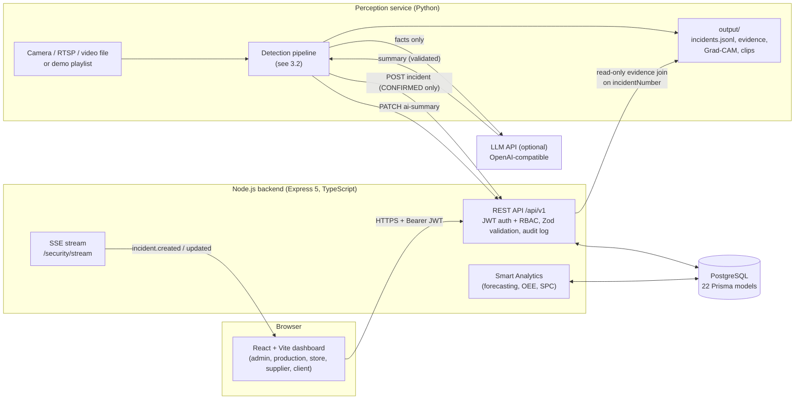
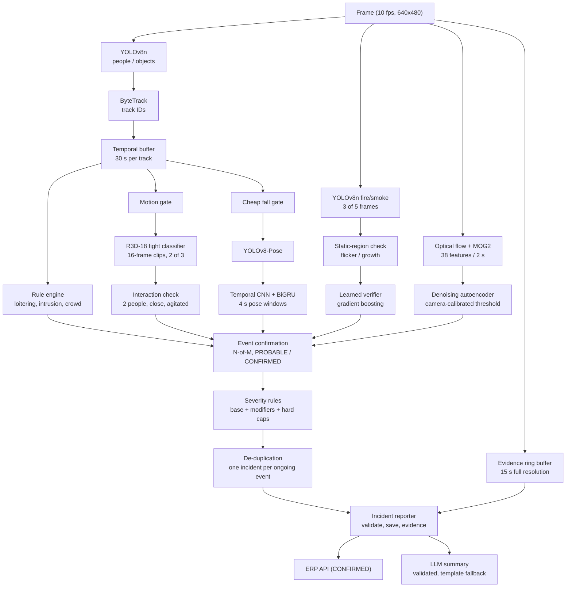
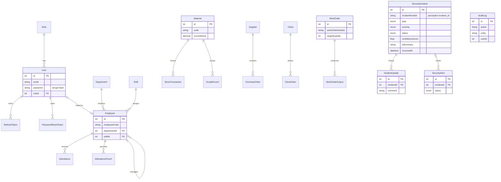
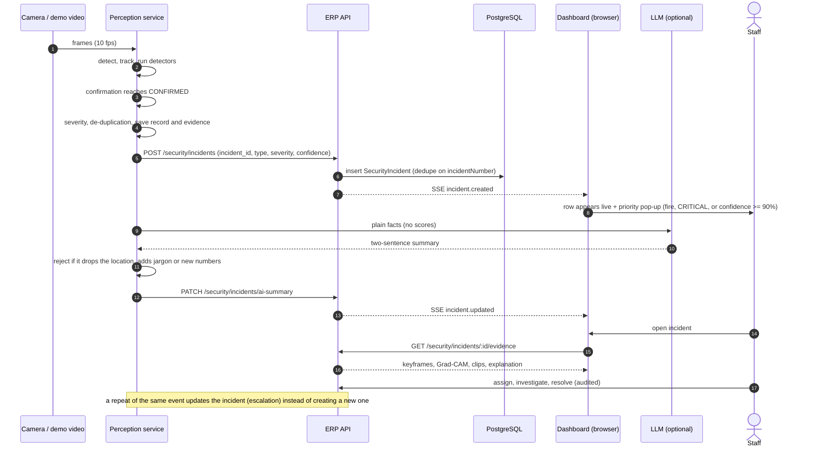

# 3. System architecture

## 3.1 Overall system

Three processes on one machine or LAN: the React dashboard, the Express API
with PostgreSQL, and the Python perception service. The perception service is
a client of the API: it logs in with a dedicated `PERCEPTION_SERVICE` role that
can only create incidents and attach summaries.

## 3.2 Perception pipeline

Each processed frame (10 per second, resized to 640×480) goes through the
stages below. The detectors run in the same loop; the expensive ones are gated
(they run only when people are close and moving, or on a stride).

## 3.3 Database (ER diagram)

The 22 Prisma models, grouped by domain. Only keys and the main fields are
shown. Perception incidents are stored in `SecurityIncident`. The
perception `incident_id` becomes `incidentNumber`, which joins the record to
its evidence files without a schema change.

## 3.4 Incident sequence

From the moment a camera sees an event until a person on the dashboard
handles it.

