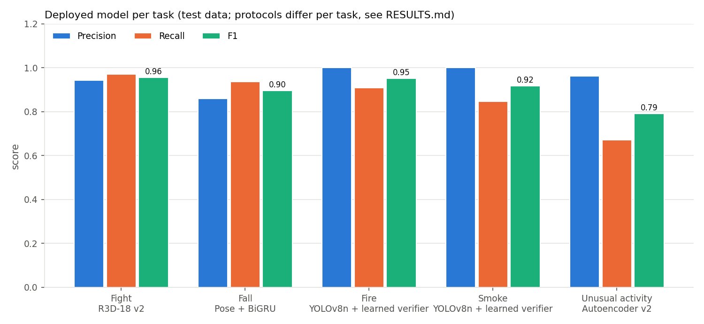
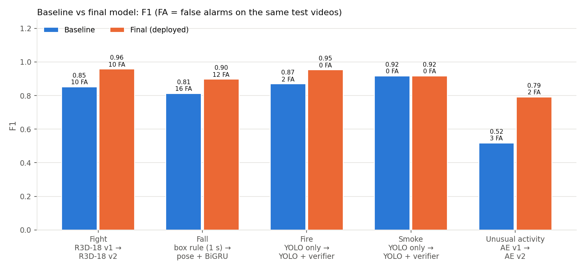
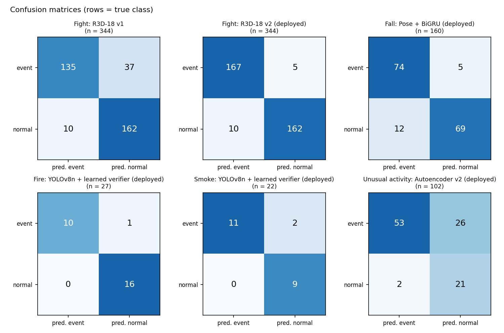

# 6. Testing and results

All model numbers below are copied from [../RESULTS.md](../RESULTS.md),
which `perception-service/evaluation/run_all.py` generates from the metrics
files saved at training time (`perception-service/models/*.json`). The script
also checks that every stored precision and recall matches its stored
confusion counts.

## 6.1 Automated tests

| Suite | Command | Result (15 Oct 2026) |
|---|---|---|
| Backend (Vitest + Supertest) | `cd backend && npm test` | 157 tests in 15 files, all passing; typecheck, ESLint and Prettier clean |
| Frontend (Vitest) | `cd frontend && npm test && npm run build` | 19 tests in 3 files, all passing; production build succeeds |
| Perception (pytest) | `cd perception-service && python -m pytest -q` | 115 tests, all passing |

The perception tests run without a camera or GPU. They cover:

- the rule engine and confirmation tiers;
- evidence extraction;
- fight gating and the interaction check;
- fall features and runtime;
- the fire verifiers;
- autoencoder gradients, training and save/load;
- incident schema validation, reporter outbox, dashboard client and de-duplication;
- LLM output validation;
- demo playlist and fail-soft model loading;
- the results collector.

`test_false_positives.py` alone runs 26 scenarios: normal activity that must
*not* alert (a person who left the zone, boundary flicker, people talking
close together, one person with two track IDs, a static orange object,
auto-exposure change, a high fight-model score without interaction) and
genuine events that must still alert.

CI (GitHub Actions) runs the three suites on every push.

## 6.2 End-to-end test

Demo mode was run against the live backend and database on 15 Oct 2026. Each
demo clip produced exactly one database incident of the right type:

- the fight clip gave one CONFIRMED FIGHT;
- the fire clip gave one incident, created at PROBABLE and escalated to
  CONFIRMED (one database row);
- the normal-activity clip gave none.

The browser received `incident.created` and then `incident.updated` (when the
LLM summary was attached) over SSE. When the playlist looped, repeats of the
same event within the de-duplication window were suppressed.

## 6.3 Model results (held-out data)

| Task | Deployed model | Precision | Recall | F1 | AUC | False alarms | Test size | Baseline (F1, false alarms) |
|---|---|---|---|---|---|---|---|---|
| Fight | R3D-18 v2, live 2-of-3 rule | 0.94 | 0.97 | **0.96** | 0.99 | 10 | 344 videos | R3D-18 v1: 0.85, 10 |
| Fall | Pose + BiGRU | 0.86 | 0.94 | **0.90** | 0.96 | 12 | 160 videos (CV) | box rule relaxed: 0.81, 16; as deployed: 0.11, 4 |
| Fire | YOLOv8n + learned verifier | 1.00 | 0.91 | **0.95** | – | 0 | 27 videos | YOLO only: 0.87, 2 |
| Smoke | YOLOv8n + learned verifier | 1.00 | 0.85 | **0.92** | – | 0 | 22 videos | YOLO only: 0.92, 0 |
| Unusual activity | Autoencoder v2 | 0.96 | 0.67 | **0.79** | 0.84 | 2 | 102 videos | autoencoder v1: 0.52, 3 |

Protocols differ per task (chapter 5.4), so compare rows only within a task.
"False alarms" = false positives on that test set.

*Figure 6.1: Precision, recall and F1 of the deployed model per task.*

*Figure 6.2: F1 and false alarms, baseline vs deployed model.*

*Figure 6.3: Confusion matrices (rows = true class).*

**Observations**

- **Fight:** v2 catches 167 of 172 test fights against v1's 135, at the same
  10 false alarms. The gain comes from training on clips sampled at the same
  real-time rate as the live pipeline (v1 trained on a fixed frame stride
  across videos of 11–37 fps).
- **Fall:** the learned model clearly beats the deployed box rule, which
  rarely fired because it waited 5 s for stillness. A Random Forest on 16
  biomechanical features reached the same F1 (0.90). `ML_AND_ANALYTICS_UPGRADE.md`
  reports a box-features-only ablation (AUC 0.92 vs 0.96), but its metrics file
  is not in the repository, so it is not in RESULTS.md.
- **Fire:** the verifier removes both YOLO false alarms without losing recall.
  YOLO's false and near-false alarms on FIRESENSE came from look-alikes such
  as an orange shopping bag, red toys and party lights. Stricter YOLO thresholds alone were
  tried and rejected: fire recall fell to 0.45.
- **Unusual activity:** high precision, moderate recall, without any labelled
  incident in training. v1's apparently weaker result was measured with a
  split that let camera angles of one event leak across train and test; v2
  fixes the split.

Full table (21 rows, including alternatives and rejected variants):
[../RESULTS.md](../RESULTS.md) section 1.

## 6.4 Speed

Measured with `python -m evaluation.benchmark`. Each device ran 100 s of the
demo playlist, paced at 10 processed frames/s as in live use, on a laptop
with an Intel CPU and an NVIDIA RTX 3050 laptop GPU.

| Stage (average ms added per frame) | GPU | CPU |
|---|---|---|
| YOLOv8n detection | 19.8 | 61.7 |
| ByteTrack | 0.4 | 0.3 |
| Rules | 0.1 | 0.1 |
| Fight (R3D-18 + interaction) | 7.2 | 19.0 |
| Fire/smoke (YOLOv8n + verifier) | 11.0 | 28.6 |
| Fall (YOLOv8-Pose + BiGRU) | 8.1 | 40.6 |
| Unusual activity | 2.9 | 2.1 |
| **Whole frame** | **51.9** | **153.8** |
| Frames/s achieved (target 10) | 9.2 | 6.1 |
| Capacity, frames/s | 19.3 | 6.5 |

The GPU sustains near real time with about 2× headroom. CPU-only operation
works but runs at about 6 frames/s. The earlier measurement in
`docs/REALTIME_SECURITY_ALERTS.md` reports a median of 0.43 s from detection to
ERP record (57 live incidents) and 11 ms from ERP to browser (n = 20). Those
figures come from that document and were not re-measured for this report.

## 6.5 False-positive fixes (before / after)

On 15 Oct 2026 the dashboard filled with false incidents during normal
activity in the test room: "lingering" at 76–77 %, "unusual activity" at
94 %, "smoke" at 80 %, and fights. Each was traced to a root cause in the
pipeline (details in `perception-service/docs/FALSE_POSITIVE_FIXES.md`):

| Incident type | Root cause (before) | Fix (after) |
|---|---|---|
| Lingering / intrusion | Ghost tracks kept for 15 s after a person left; dwell measured from a never-cleared first sighting; confidence = `0.5 + dwell/40` (a made-up number that rose with time); placeholder zone covering 31 % of the view | Only tracks seen in the last 1 s; dwell from observations inside the zone with 2 s exit grace; ≥ 80 % inside; confidence = detector confidence × inside fraction; start-up warning for oversized zones |
| Fight | Motion gate paired a person's old and new track IDs; speed from 2 samples (jitter opened the gate); incident from the clip score alone | Interaction check (two distinct people, close ≥ 1 s, agitated); speed over 0.5 s; duplicates by IoU ≥ 0.7 |
| Fire / smoke | Static look-alikes persisted frame after frame; verifier kept old approvals forever | Static-region check (in-box change ≥ 2× the scene); verifier reset when persistence ends; confidence = mean, not peak |
| Unusual activity | Threshold from training footage of another site: normal movement here was always above it | 5-minute per-camera calibration (99th percentile) without alerting; score `ratio/(ratio+1)`, labelled as a score, not a probability |

All records now carry `validation_version: 2` and a `confidence_basis`.

**What is measured and what is not.** The 26 regression scenarios pass, and
the demo clips raise their incidents. A rate of false alarms per hour on real
normal footage has **not** been measured yet, because no 10–15-minute
normal-activity recording is available. The script
(`python -m evaluation.false_alarms --video <recording>`) runs the same
recording through the code before and after the fixes and adds the table to
RESULTS.md section 2.
